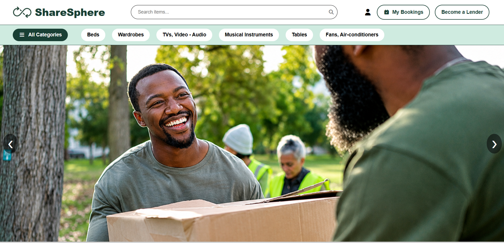
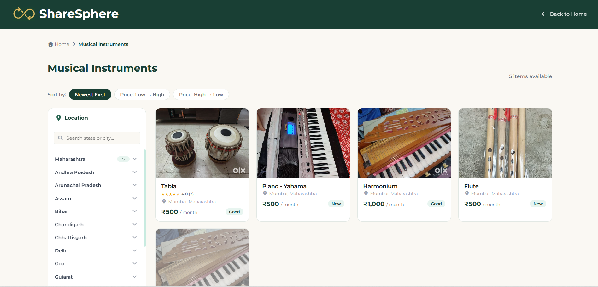
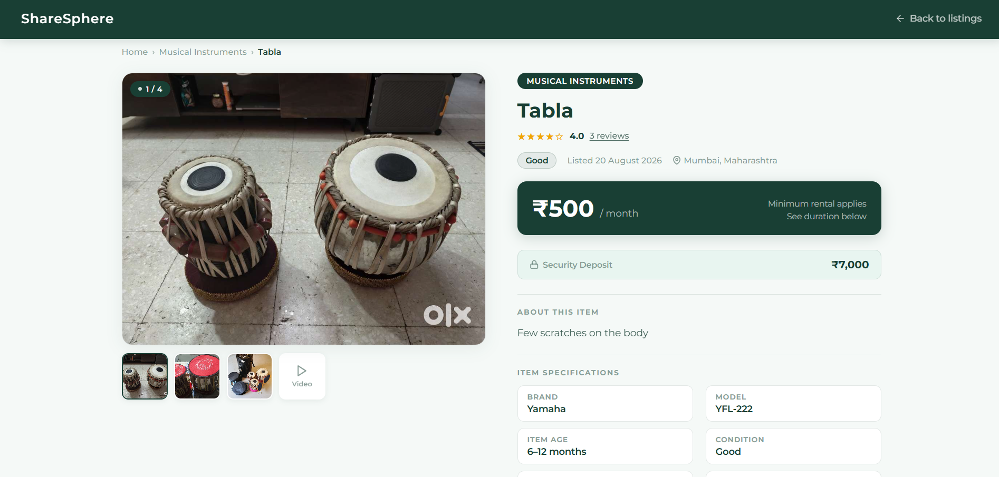
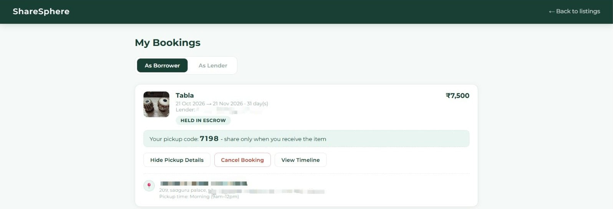
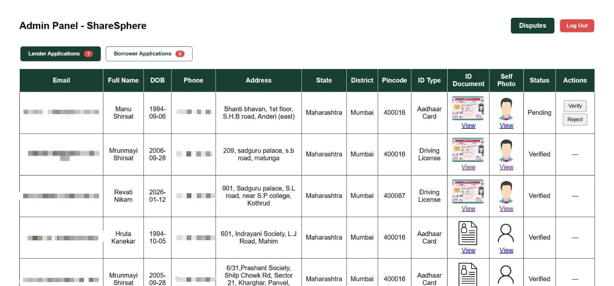

# ShareSphere

A rental platform where people can lend and borrow everyday items from each other, with verified users and payments that are held until the item actually changes hands.

## Screenshots







## How it works

Lenders and borrowers are ID-verified by an admin first. A borrower books an item and pays rent plus a refundable deposit through Razorpay. The money is held until pickup, where the borrower gives the lender a one-time code and the lender uploads a photo of the item. The same code-and-photo step happens at return, and the deposit goes back. If something is damaged, either side can raise a dispute with a photo, and the admin decides the deduction. Before pickup, a borrower can cancel for a full refund.

## What I built

- Razorpay checkout with server-side payment signature verification (HMAC SHA-256)
- A booking flow with clear stages: pending payment, held, active, completed, cancelled, disputed
- Double-booking prevention using a date-overlap check, with unpaid holds expiring after 15 minutes
- Code-and-photo handover at pickup and return
- Real refunds through the Razorpay API for cancellations and for partial refunds after disputes
- A ledger that records every payment, release and refund, shown to users as a booking timeline
- Admin pages to verify users and resolve disputes
- Email notifications for OTPs, verification results, bookings and cancellations
- Ratings and reviews, limited to the borrower of a completed booking

## Tech stack

Node.js, Express, MySQL, Razorpay, Nodemailer, Multer, bcrypt, and plain HTML/CSS/JavaScript.

## Run it locally

You need Node.js 18+ and MySQL.

```
git clone https://github.com/Mrunmayi30/ShareSphere.git
cd ShareSphere
npm install
```

1. Create a MySQL database and import `database/schema.sql`.
2. Create a `.env` file with these names: `PORT`, `DB_HOST`, `DB_USER`, `DB_PASSWORD`, `DB_NAME`, `EMAIL_USER`, `EMAIL_PASS`, `RAZORPAY_KEY_ID`, `RAZORPAY_KEY_SECRET`. Use your own values (Razorpay test keys, and a Gmail app password).
3. Create `config/razorpay.js`. It is not committed. It should export `new Razorpay({ key_id, key_secret })` using the two Razorpay values from `.env`.
4. Create an empty `uploads` folder.
5. Run `npm start` and open http://localhost:5000.

The admin pages are `admin.html` and `admin-disputes.html`.

## Limitations

- Payments run in Razorpay test mode. The rent "released" to the lender is only recorded in the database, because real payouts need Razorpay Route and business KYC.
- ID verification is manual. The admin reviews the documents by eye.
- Login is basic (no tokens yet) and the admin pages have no login. JWT authentication is the first thing I would add.

## Author

Mrunmayi Shirsat
GitHub: [Mrunmayi30](https://github.com/Mrunmayi30) | LinkedIn: [https://www.linkedin.com/in/mrunmayishirsat/]
